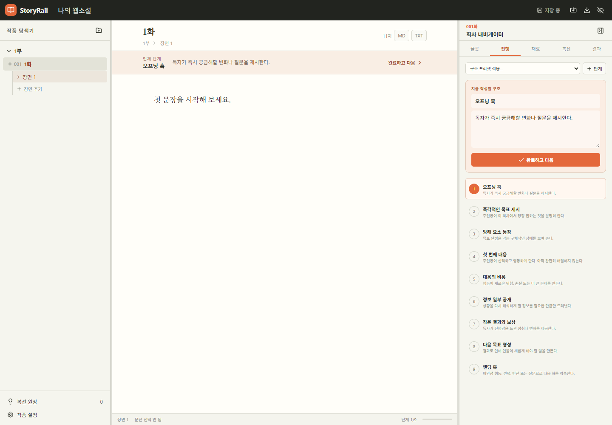

# StoryRail

웹소설 작가가 원고를 직접 쓰는 동안 회차 플롯, 구조 진행 단계, 재료 체크리스트와 복선을 옆에서 관리하는 로컬 우선 집필 IDE입니다.



## 실행

```bash
npm install
npm run dev
```

프로덕션 빌드:

```bash
npm run build
npm run preview
```

테스트:

```bash
npm test
npm run test:e2e
```

## 데이터와 백업

- 프로젝트는 브라우저의 IndexedDB에 자동 저장됩니다.
- 상단의 내보내기 버튼으로 `.storyrail.json` 전체 백업을 만드세요.
- 가져오기 버튼으로 백업을 복원할 수 있습니다.
- 회차 원고는 편집기 상단에서 Markdown 또는 TXT로 별도 내보낼 수 있습니다.

브라우저 데이터 삭제 시 로컬 프로젝트도 사라질 수 있으므로 중요한 작업은 JSON으로 정기 백업하세요.

## 주요 단축키

| 동작                  | 단축키       |
| --------------------- | ------------ |
| 현재 구조 단계 완료   | `Ctrl+Enter` |
| 회차 가이드 열기/닫기 | `Ctrl+J`     |
| 즉시 저장             | `Ctrl+S`     |

## 현재 알려진 제한 사항

- 집중 모드에는 아직 종료 버튼과 종료 단축키가 없습니다. 현재 버전에서는 집중 모드 사용을 권장하지 않습니다.
- 새 작품 생성·전환, 사용자 정의 프리셋 편집, 작품 설정 화면은 아직 구현되지 않았습니다.
- 데이터 스키마 버전은 기록하지만 버전 간 자동 마이그레이션 처리는 아직 구현되지 않았습니다.

남은 작업은 [`../docs/WRITING_IDE_PLAN_KO.md`](../docs/WRITING_IDE_PLAN_KO.md)의 후속 작업 체크리스트에서 관리합니다.
